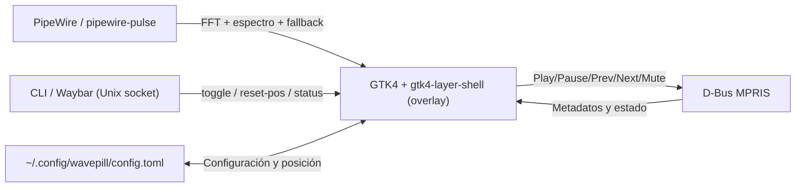

# wavepill

Overlay nativo para Wayland/Hyprland estilo *Dynamic Island* escrito en Rust con **GTK4**, `gtk4-layer-shell`, **PipeWire** (vía compatibilidad PulseAudio) y **MPRIS** sobre D-Bus.

## Características

- **Cápsula *Dynamic Island* sin robar foco:** Anclada mediante `gtk4-layer-shell` (`Layer::Overlay`, `KeyboardMode::None`, namespace `wavepill`).
- **Ecualizador de espectro en tiempo real:** Captura directa de `@DEFAULT_MONITOR@` en PipeWire procesada con ventana de Hann + `rustfft` en 12 bandas logarítmicas a ~60 FPS en Cairo (timer bajo demanda, ~0% CPU cuando está oculta).
- **Control híbrido MPRIS + PipeWire:** Detecta reproductores MPRIS (Spotify, navegador, VLC, etc.) con carátula, título, artista y `Play/Pause`, `Previous`, `Next`; y hace fallback automático a *sink-inputs* de PipeWire (Mute/Unmute) para apps sin MPRIS.
- **Arrastre libre con el mouse:** Arrastra la cápsula con clic izquierdo a cualquier punto del monitor; la nueva posición (`margin_x`, `margin_y`) se guarda automáticamente en `~/.config/wavepill/config.toml`.
- **Control IPC y CLI para Waybar / atajos:** Activa, desactiva, consulta estado JSON o restablece la posición desde terminal o desde tu barra superior.



## Requisitos en Arch Linux

Instala las dependencias nativas del sistema y la toolchain de Rust:

```bash
sudo pacman -S --needed gtk4 gtk4-layer-shell libpulse pipewire-pulse rust
```

> [!NOTE]
> Si utilizas `rustup`, asegúrate de tener una toolchain estable reciente (el crate usa `edition = "2024"`).

## Compilación y ejecución manual desde terminal

Compila el binario optimizado en modo release:

```bash
cargo build --release
```

Ejecútalo directamente desde la terminal en tu sesión Wayland activa:

```bash
RUST_LOG=info ./target/release/wavepill
```

Si omites `RUST_LOG`, `wavepill` utiliza `wavepill=info` por defecto. Para detenerlo, presiona `Ctrl+C` en la terminal.

## Comandos CLI / IPC

Mientras `wavepill` está corriendo (escuchando en `$XDG_RUNTIME_DIR/wavepill.sock`), puedes controlarlo desde otra terminal, Waybar o un atajo de Hyprland:

```bash
./target/release/wavepill toggle     # Activa/desactiva la cápsula (o inicia el daemon si está detenido)
./target/release/wavepill enable     # Activa la aparición de la cápsula
./target/release/wavepill disable    # Oculta y desactiva la cápsula hasta volver a habilitarla
./target/release/wavepill reset-pos  # Restablece la posición a la esquina por defecto (16, 48)
./target/release/wavepill status     # Imprime JSON compatible con Waybar (enabled/disabled/stopped)
```

## Configuración

`wavepill` busca (y guarda al arrastrar) su archivo de configuración en:

```text
~/.config/wavepill/config.toml
```

Puedes partir de [config.example.toml](./config.example.toml):

```bash
mkdir -p ~/.config/wavepill
cp config.example.toml ~/.config/wavepill/config.toml
```

### Opciones disponibles

| Clave | Tipo | Por defecto | Descripción |
| :--- | :--- | :--- | :--- |
| `corner` | string | `"top-right"` | Esquina de anclaje: `"top-right"`, `"top-left"`, `"bottom-right"` o `"bottom-left"`. |
| `margin_x` | entero (`i32`) | `16` | Margen horizontal desde el borde de pantalla (px). |
| `margin_y` | entero (`i32`) | `48` | Margen vertical desde el borde de pantalla (px). |
| `hide_delay_ms` | entero (`u64`) | `3000` | Retardo en ms para ocultar la píldora cuando cesa la actividad. |
| `bar_count` | entero (`usize`) | `12` | Número de barras del ecualizador (ajustado automáticamente a `4..=32`). |
| `accent_color` | string | `"#7aa2f7"` | Color hexadecimal `#RRGGBB` para las barras del espectro. |
| `ignore_apps` | lista de strings | `[]` | Aplicaciones ignoradas en detección MPRIS y audio (ej. `["firefox", "chromium"]`). |

Si el archivo no existe, `wavepill` arranca con los valores por defecto. Si contiene errores de sintaxis o tipos inválidos, registra una advertencia (`tracing::warn`) y aplica la configuración por defecto.

## Integración con Waybar (opcional)

Añade `"custom/wavepill"` a tu lista de módulos en `~/.config/waybar/config.jsonc` (requiere Nerd Font para los íconos `󱑽` / `󰎊`):

```jsonc
"custom/wavepill": {
  "exec": "/ruta/a/wavepill status",
  "return-type": "json",
  "signal": 11,
  "interval": 5,
  "on-click": "/ruta/a/wavepill toggle",
  "on-click-right": "/ruta/a/wavepill reset-pos"
}
```

Y en `~/.config/waybar/style.css`:

```css
#custom-wavepill {
  min-width: 12px;
  margin: 0 7.5px;
}

#custom-wavepill.disabled,
#custom-wavepill.stopped {
  opacity: 0.45;
}
```

## Integración con Hyprland (opcional)

Cuando quieras iniciarlo automáticamente con tu sesión de Hyprland y aplicar reglas al namespace `wavepill`:

```ini
# ~/.config/hypr/autostart.conf (opcional)
exec-once = /ruta/al/repo/target/release/wavepill
```

```ini
# Reglas opcionales para el layer-shell namespace "wavepill" (Hyprland)
layerrule = noanim, wavepill
layerrule = blur, wavepill
layerrule = ignorezero, wavepill
```

*(En versiones recientes de Hyprland que usen la sintaxis de bloque `layerrule { ... }`, adapta las propiedades anteriores manteniendo `match:namespace = ^wavepill$`.)*

## Verificación

Para ejecutar toda la suite de pruebas (unitarias + integración E2E):

```bash
cargo test
```

## Licencia

Distribuido bajo licencia [MIT](./LICENSE).
