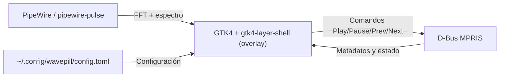

# wavepill

Overlay nativo para Wayland/Hyprland estilo *Dynamic Island* escrito en Rust con **GTK4**, `gtk4-layer-shell`, **PipeWire** (vía compatibilidad PulseAudio) y **MPRIS** sobre D-Bus.

## Propósito y arquitectura

`wavepill` permanece oculto hasta detectar actividad de audio o reproducción multimedia, mostrando una píldora flotante en una esquina de la pantalla con un ecualizador de espectro en tiempo real y controles/metadatos MPRIS sin robar el foco del teclado (`KeyboardMode::None`, namespace `wavepill`).



## Requisitos en Arch Linux

Instala las dependencias nativas del sistema y la toolchain de Rust:

```bash
sudo pacman -S --needed gtk4 gtk4-layer-shell libpulse pipewire-pulse rust
```

> [!NOTE]
> Si utilizas `rustup`, asegúrate de tener una toolchain estable reciente (el crate usa `edition = "2024"`).

## Compilación y ejecución manual desde terminal

Compila el binario optimizado en modo release:

```bash
cargo build --release
```

Ejecútalo directamente desde la terminal en tu sesión Wayland activa:

```bash
RUST_LOG=info ./target/release/wavepill
```

Si omites `RUST_LOG`, `wavepill` utiliza `wavepill=info` por defecto. Para detenerlo, presiona `Ctrl+C` en la terminal.

## Configuración

`wavepill` busca su archivo de configuración en:

```text
~/.config/wavepill/config.toml
```

Puedes partir de [config.example.toml](./config.example.toml):

```bash
mkdir -p ~/.config/wavepill
cp config.example.toml ~/.config/wavepill/config.toml
```

### Opciones disponibles

| Clave | Tipo | Por defecto | Descripción |
| :--- | :--- | :--- | :--- |
| `corner` | string | `"top-right"` | Esquina de anclaje: `"top-right"`, `"top-left"`, `"bottom-right"` o `"bottom-left"`. |
| `margin_x` | entero (`i32`) | `16` | Margen horizontal desde el borde de pantalla (px). |
| `margin_y` | entero (`i32`) | `48` | Margen vertical desde el borde de pantalla (px). |
| `hide_delay_ms` | entero (`u64`) | `3000` | Retardo en ms para ocultar la píldora cuando cesa la actividad. |
| `bar_count` | entero (`usize`) | `12` | Número de barras del ecualizador (ajustado automáticamente a `4..=32`). |
| `accent_color` | string | `"#7aa2f7"` | Color hexadecimal `#RRGGBB` para las barras del espectro. |
| `ignore_apps` | lista de strings | `[]` | Aplicaciones ignoradas en detección MPRIS y audio (ej. `["firefox", "chromium"]`). |

Si el archivo no existe, `wavepill` arranca con los valores por defecto. Si contiene errores de sintaxis o tipos inválidos, registra una advertencia (`tracing::warn`) y aplica la configuración por defecto.

## Integración con Hyprland (cuando quieras automatizarlo)

> [!TIP]
> Esta integración es **completamente opcional**. Puedes seguir lanzando `wavepill` manualmente desde terminal mientras lo pruebas.

Cuando quieras iniciarlo automáticamente con tu sesión de Hyprland y aplicar reglas al namespace `wavepill` de `gtk4-layer-shell`, añade lo siguiente en tu configuración de Hyprland (por ejemplo `~/.config/hypr/autostart.conf` y tu archivo de reglas de ventana/capa):

```ini
# ~/.config/hypr/autostart.conf (opcional)
exec-once = /ruta/al/repo/target/release/wavepill
```

```ini
# Reglas opcionales para el layer-shell namespace "wavepill" (Hyprland)
layerrule = noanim, wavepill
layerrule = blur, wavepill
layerrule = ignorezero, wavepill
```

*(En versiones recientes de Hyprland que usen la sintaxis de bloque `layerrule { ... }`, adapta las propiedades anteriores manteniendo `match:namespace = ^wavepill$`.)*

## Verificación

Para ejecutar la suite de pruebas unitarias (incluyendo el parser y los valores por defecto de configuración):

```bash
cargo test
```
